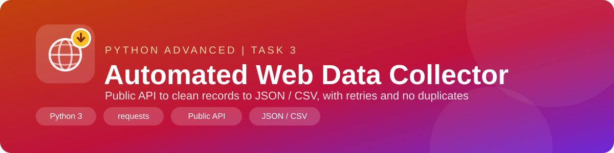
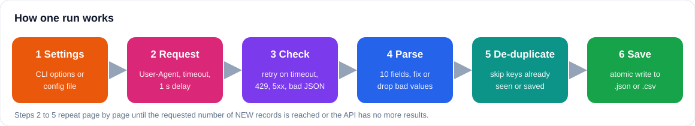
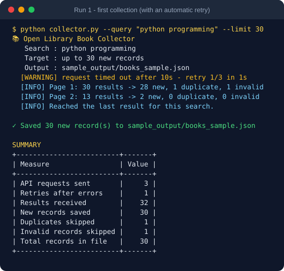
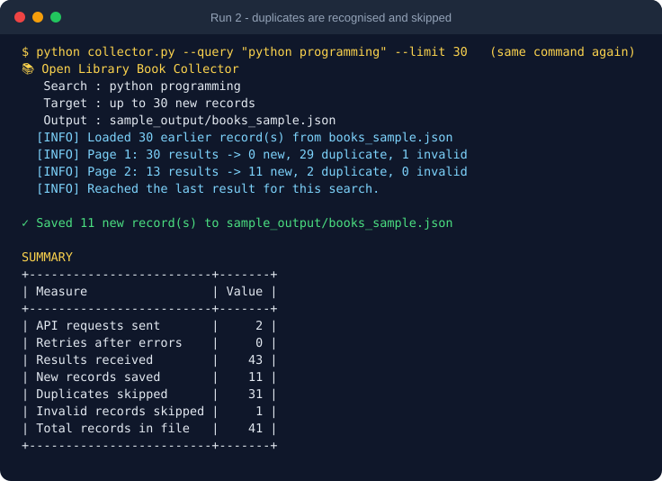
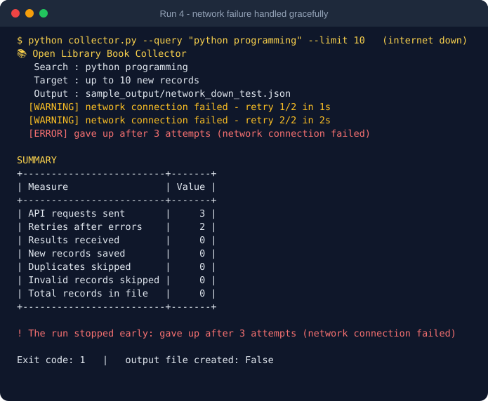
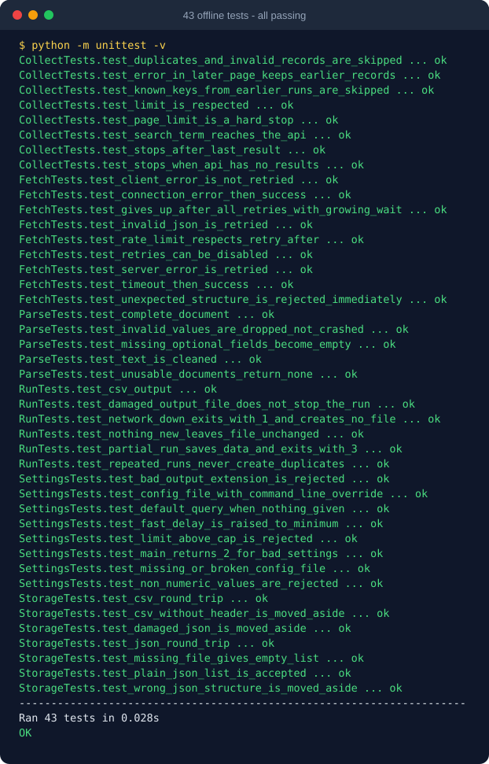

<p align="center">
  
</p>

<p align="center">
  
  
  
  
  
  
</p>

<h1 align="center"> Automated Web Data Collector</h1>

<p align="center">
  Collects structured book records from a public API, handles every kind of network problem,<br>
  never saves the same record twice, and stores the result as JSON or CSV.<br>
  <b>Python Programming - Advanced Level | Task 3</b>
</p>

---

## 📑 Table of Contents
1. [Overview](#-overview)
2. [Data Source and Permission](#-data-source-and-permission)
3. [Important Note About the Sample Output](#%EF%B8%8F-important-note-about-the-sample-output)
4. [How It Works](#-how-it-works)
5. [Quick Start](#-quick-start)
6. [Options and Configuration](#%EF%B8%8F-options-and-configuration)
7. [Collected Fields](#-collected-fields)
8. [Error Handling](#%EF%B8%8F-error-handling)
9. [Duplicate Prevention](#-duplicate-prevention)
10. [Polite Access](#-polite-access)
11. [Screenshots and Terminal Output](#-screenshots-and-terminal-output)
12. [Project Structure](#-project-structure)
13. [Requirements Checklist](#-requirements-checklist)

---

## 🔭 Overview

| | |
|---|---|
| **Goal** | Collect book information for any search term or subject and save it for later analysis |
| **Source** | Open Library Search API (public, free, no API key) |
| **Libraries** | `requests` plus the Python standard library |
| **Fields per record** | 10 (title, authors, year, editions, languages, subjects, rating, URL...) |
| **Output** | `.json` or `.csv`, chosen by the file extension |
| **Tests** | 43 offline unit tests |

---

## 🔐 Data Source and Permission

The task asks to use a public API where available, so **no web page is scraped**.

| Question | Answer |
|---|---|
| **Which API?** | [Open Library Search API](https://openlibrary.org/developers/api) - `https://openlibrary.org/search.json` |
| **Is a key needed?** | No |
| **What do the rules ask?** | Send a `User-Agent` with the app name and a contact; stay within about 1 request per second (3 per second for identified apps); do **not** use the API for bulk downloads. |
| **How does this tool comply?** | See [Polite Access](#-polite-access) below. |

> I checked these rules on the Open Library developer page while writing this project. Rules can change, so please read the page again before heavy use.

---

## ⚠️ Important Note About the Sample Output

The environment where this project was written had **no internet access**, so the collector could not be run against the real Open Library there. To still prove that everything works, the project includes an **offline demo** (`offline_demo.py`) that replaces the network with a **fake API**.

| File | How it was made |
|---|---|
| `sample_output/books_sample.json` / `.csv` | Produced by `offline_demo.py` from **synthetic** records. Every title starts with `[DEMO]`. They are **not real books**. |
| `sample_output/demo_terminal_output.txt` | Terminal output of that demo. |
| `sample_output/real_run_no_internet.txt` | A **real** run of `collector.py` with the real `requests` library but no internet: it shows the graceful failure. |
| `tests/` | 43 tests that simulate timeouts, HTTP errors, bad JSON, damaged files and more. |

**To produce real output and screenshots for your submission**, run this on your own computer (with internet), after putting your own email in `--user-agent`:

```bash
python collector.py --subject "data science" --limit 30 --user-agent "MyBookCollector/1.0 (you@email.com)"
```

Then take a screenshot of the terminal and include `data/books.json`.

---

## 🧭 How It Works

<p align="center"></p>

1. **Settings** are read from command-line options or a JSON config file and validated.
2. A **request** is sent with a clear `User-Agent`, a timeout and a pause between pages.
3. The **response is checked**; temporary problems are retried with growing waits.
4. Each document is **parsed** into a clean record; unusable ones are skipped and counted.
5. Records already collected (in this run or earlier runs) are **skipped**.
6. New records are **merged** with the old file and saved **atomically**.

---

## 🚀 Quick Start

```bash
pip install -r requirements.txt

# Collect 30 books about a subject (saved to data/books.json)
python collector.py --subject "data science" --limit 30 --user-agent "MyApp/1.0 (you@email.com)"

# Free-text search, saved as CSV
python collector.py --query "web scraping" --output data/scraping.csv

# Use a config file
python collector.py --config config.example.json

# No internet? Watch the offline demo and run the tests
python offline_demo.py
python -m unittest -v
```

---

## 🎛️ Options and Configuration

| Option | Short | Default | Meaning |
|---|:-:|---|---|
| `--query` | `-q` | *(none)* | Free-text search, e.g. `"web scraping"` |
| `--subject` | `-s` | *(none)* | Category / subject, e.g. `"data science"` |
| `--limit` | `-n` | `30` | Number of **new** records to collect (1 to 200) |
| `--output` | `-o` | `data/books.json` | Output file; `.json` or `.csv` |
| `--delay` | | `1.0` | Seconds between requests (never below 1.0) |
| `--timeout` | | `10` | Seconds to wait for each response |
| `--retries` | | `3` | Retries after a temporary error (0 to 5) |
| `--user-agent` | | placeholder | Identify your app: `"Name/1.0 (you@email.com)"` |
| `--config` | | | JSON file with the same settings; command-line options win |

If neither `--query` nor `--subject` is given, the default search is `python programming`. If both are given they are combined, for example `web scraping subject:"data science"`.

**Config file** (`config.example.json`):

```json
{
  "query": "",
  "subject": "data science",
  "limit": 40,
  "output": "data/data_science_books.csv",
  "delay": 1.5,
  "timeout": 10,
  "retries": 3,
  "user_agent": "BookCollectorStudentProject/1.0 (your-email@example.com)"
}
```

**Exit codes**

| Code | Meaning |
|:-:|---|
| `0` | Success (including "nothing new to save") |
| `1` | Failed, nothing was collected |
| `2` | Invalid settings |
| `3` | Partly collected: an error stopped the run, but the records found were saved |

---

## 🗃️ Collected Fields

Ten fields are collected for every record, so the requirement of at least four is covered.

| Field | Type | Description | Always present? |
|---|---|---|:-:|
| `work_key` | text | Unique Open Library ID, e.g. `/works/OL1001W` | yes (else skipped) |
| `title` | text | Book title | yes (else skipped) |
| `authors` | text | Up to 5 authors, separated by `; ` | no |
| `first_publish_year` | integer | Year of first publication (1000 to next year) | no |
| `edition_count` | integer | Number of known editions | no |
| `languages` | text | Language codes separated by a vertical bar, e.g. `eng\|fre` | no |
| `subjects` | text | Up to 5 subjects separated by a vertical bar | no |
| `rating_average` | number | Average reader rating, 0 to 5 | no |
| `url` | text | Link to the book page | yes |
| `collected_at` | text | UTC time of collection | yes |

**JSON record** (from the offline demo; `[DEMO]` marks synthetic data):

```json
{
  "work_key": "/works/OL1001W",
  "title": "[DEMO] Data Structures Vol. 01",
  "authors": "Demo Author B",
  "first_publish_year": 2002,
  "edition_count": 4,
  "languages": "eng|urd",
  "subjects": "Data Structures|Programming|Computer science|Demo data",
  "rating_average": 3.3,
  "url": "https://openlibrary.org/works/OL1001W",
  "collected_at": "2026-11-13T04:12:00Z"
}
```

**CSV preview** (`sample_output/books_sample.csv`)

| work_key | title | authors | first_publish_year | edition_count | rating_average |
|---|---|---|---:|---:|---:|
| /works/OL1001W | [DEMO] Data Structures Vol. 01 | Demo Author B | 2002 | 4 | 3.3 |
| /works/OL1002W | [DEMO] Web Scraping Vol. 02 | Demo Author C | 2009 | 7 | 3.4 |
| /works/OL1003W | [DEMO] Machine Learning Vol. 03 | Demo Author D | 2016 | 10 | 3.5 |

---

## 🛡️ Error Handling

Every case below is covered by a test in `tests/test_collector.py`.

| Problem | What the collector does |
|---|---|
| **Timeout** | Retries with waits of 1 s, 2 s, 4 s... (up to `--retries`), then stops cleanly |
| **No network / connection error** | Same retry logic; if all fail, nothing crashes and the exit code is 1 |
| **HTTP 429 (too many requests)** | Waits for the server's `Retry-After` time (maximum 30 s) and retries |
| **HTTP 5xx (server error)** | Retried like a timeout |
| **HTTP 4xx (e.g. 404)** | Not retried, because repeating cannot fix it; the error is reported |
| **Invalid JSON** (e.g. an HTML error page) | Retried, then reported |
| **Unexpected response structure** | Rejected immediately with a clear message |
| **Missing fields** | Optional fields become empty (`null` / blank); records without `key` or `title` are skipped and counted |
| **Invalid values** (year `"abc"`, rating `9`, negative editions) | The bad value is dropped instead of crashing |
| **Error in the middle of a run** | Records already collected are **kept and saved** (exit code 3) |
| **Damaged output file** | Moved to `*.corrupt-<time>` and a new file is started |
| **Wrong settings** | Clear message and exit code 2 (for example `--limit 9999`) |
| **Ctrl+C** | Stops politely; saved data is kept |

---

## 🔁 Duplicate Prevention

Each Open Library work has a unique `work_key`. The collector keeps two sets of keys:

* keys already **in the output file** (loaded at the start of every run), and
* keys already **seen in the current run**.

A record whose key is in either set is skipped, so repeated runs never store a book twice. Re-running the same command simply continues with books that are not in the file yet. The offline demo shows this: Run 1 saves 30 records, and Run 2 (the same command) recognises them and saves only the 11 new ones, for 41 in total with no repeats.

---

## 🤝 Polite Access

| Rule | How it is applied |
|---|---|
| Identify the application | `User-Agent` header from `--user-agent`; a tip is shown if you forget your own contact |
| About 1 request per second | A pause of at least 1 second between requests; smaller `--delay` values are raised to 1.0 |
| No bulk downloads | Maximum 200 records per run, 50 per request, at most 10 requests per run |
| Do not hammer a failing server | Retries wait longer each time and the number of retries is limited |
| Only ask for needed data | The `fields` parameter requests just the 8 fields the tool uses |

---

## 🖼️ Screenshots and Terminal Output

> These screenshots come from the **offline demo** (synthetic `[DEMO]` data) and the real unit tests. See the [note above](#%EF%B8%8F-important-note-about-the-sample-output). Replace them with real screenshots from your own run before submitting.

**Run 1 - first collection, with one simulated timeout that is retried automatically**



**Run 2 - the same command again: duplicates are recognised, only new records are added**



**Run 4 - internet down: no crash, clear message, no empty file created**



**43 offline tests, all passing**



Full text versions: [`demo_terminal_output.txt`](sample_output/demo_terminal_output.txt) and [`real_run_no_internet.txt`](sample_output/real_run_no_internet.txt).

---

## 📁 Project Structure

```
Task3_Web_Data_Collector/
├── collector.py                # the collector (settings, HTTP, parsing, dedupe, storage)
├── offline_demo.py             # runs the collector against a fake API (no internet)
├── config.example.json         # example configuration file
├── requirements.txt            # requests
├── README.md
├── assets/                     # banner, icon, diagram, screenshots
├── sample_output/
│   ├── books_sample.json       # demo output (synthetic [DEMO] data)
│   ├── books_sample.csv        # demo output as CSV
│   ├── demo_terminal_output.txt
│   └── real_run_no_internet.txt
└── tests/
    ├── fakes.py                # fake HTTP session and synthetic demo documents
    └── test_collector.py       # 43 unit tests
```

| Part of `collector.py` | Role |
|---|---|
| `Settings`, `validate`, `build_settings` | Read and check options and config file |
| `fetch_page` | One page with timeout, retries and backoff |
| `parse_book` | Turn a raw document into a clean record |
| `collect` | Pagination, duplicate checks, page limit |
| `load_existing`, `save_records` | Read old results, atomic save to JSON or CSV |
| `run`, `main` | Summary tables and exit codes |

---

## 🎯 Requirements Checklist

| Requirement | Status | Where |
|---|:-:|---|
| Use a public API (or scrape only where permitted) | ✅ | Open Library Search API, no scraping |
| At least four fields per record, as structured data | ✅ | 10 fields, [Collected Fields](#-collected-fields) |
| Handle timeouts, network errors, missing fields, invalid responses | ✅ | [Error Handling](#%EF%B8%8F-error-handling), tests |
| Avoid excessive requests and follow access rules | ✅ | [Polite Access](#-polite-access) |
| Save to CSV or JSON | ✅ | Both, chosen by extension |
| Prevent accidental duplicates | ✅ | [Duplicate Prevention](#-duplicate-prevention) |
| Command-line option or configuration for search/category | ✅ | `--query`, `--subject`, `--config` |
| Source code and README | ✅ | This folder |
| Sample output and terminal output | ✅ | `sample_output/` (offline demo, see the note), plus your own live run |

---

<p align="center">Made with Python 🐍 requests 🌐 | Domain 3 - Task 3</p>
